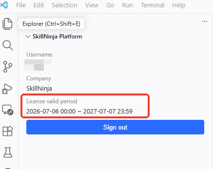
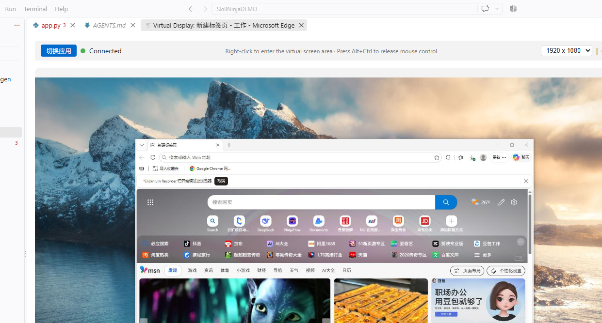
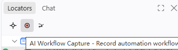
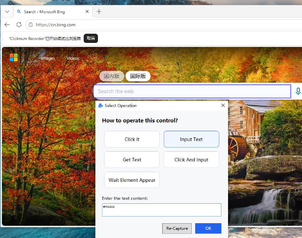
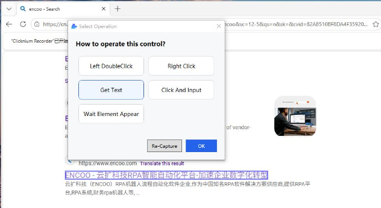

# 🚀 安装

## 1. 先决条件

### 系统要求

|  | 主要版本 |
| --- | --- |
| Python | 3.7、3.8、3.9、3.10、3.11 |
| OS | Windows 11，推荐 Windows 10；Windows 7 SP1\* 及以上 |

 Windows 10 是 DPI 感知支持的最低 Windows 操作系统版本。

### 测试账号
- 申请云扩超自动化平台（https://console.encoo.com）的企业级账号，当前完整的功能测试需要用到云扩的超自动化平台。

## 2. 代码编辑器

- Visual Studio Code

安装windows版本Visual Studio Code： https://code.visualstudio.com/


## 3. 安装SkillNinja插件


### 获取插件

- 登录云扩超自动化平台，在首页下载“SkillNinja VS Code扩展”，如下图所示：


### 从VSCode安装

**步骤 1**：打开VSCode，切到Extensions栏

**步骤 2**：点击Extensions栏右上角的"..."

**步骤 3**：下拉菜单中点击"Install from VSIX...",浏览选中你下载的SKillNinja插件


### 自动化组件安装
安装好插件后，VSCode左侧栏会多一个"SkillNinja Explorer", 点击切换过去，你会看到如图所示：


**步骤 1**：切换到"SkillNinja Explorer"

**步骤 2**：点击安装Python module，这里主要包含了clicknium自动化库

**步骤 3**：点击安装"Virtual display module", 用于在VSCode中可视化录制本机应用

**步骤 4**：根据你要自动化的浏览器，安装对应的浏览器自动化插件。 如果你要自动化Java应用，则需要安装下面的Java自动化插件

### 登录你的云扩超自动化平台测试账号
登录你的云扩账号并选择许可后，如下图所示，至此，你可以使用SkillNinja插件编写自动化流程了。



## 4. 自动化示例

获取一个展示网页和记事本自动化的示例脚本。

### **1. 设置示例项目**

- 按"Ctrl+F6"创建新的SkillNinja项目，我们选择目录D:\SkillNinjaDEMO，确定后，一个sample项目将被创建在所选择的目录之下，包含如下所示内


    插件会帮你自动生成项目文件：
    - app.py 项目代码入口文件
    - logo.ico 项目icon图标
    - clicknium.yaml 项目打包说明文件
    - AGENTS.md/CLAUDE.md 给AIAGent的使用说明
    - .locator目录用于存放录制的控件的selector描述

    其中app.py文件中有如下代码：

    ```python
    import argparse
    import subprocess
    from time import sleep
    from clicknium import clicknium as cc, locator, ui

    # How to use parameters:
    # 1. Input: declare parameters under requirements.args in clicknium.yaml
    #    (alias/dest/default/type/required/help).
    # 2. Read them with argparse in the entry point, keeping them consistent with the yaml:
    #    python app.py --keyword hello --wait 5
    # 3. Output: report the final result (a single string) with cc.set_result(...)
    #    right before the workflow ends.

    def parse_args():
        parser = argparse.ArgumentParser(description="Clicknium sample")
        parser.add_argument("--keyword", dest="keyword", type=str, default="hello world",
                            help="text to search in bing and type in notepad")
        parser.add_argument("--wait", dest="wait", type=int, default=3,
                            help="seconds to wait after searching")
        return parser.parse_known_args()[0]


    def main():
        args = parse_args()
        
        # Sample code to demo web automation and desktop application
        tab = cc.edgecdp.open("https://www.bing.com/")
        tab.find_element(
            locator.sample.bing.search_sb_form_q).set_text(args.keyword)
        tab.find_element(locator.sample.bing.svg).click()
        sleep(args.wait)
        tab.close()

        process = subprocess.Popen("notepad")
        ui(locator.sample.notepad.document_15).set_text(args.keyword)

        # Output parameter example: return the text typed in notepad as the workflow result
        cc.set_result(ui(locator.sample.notepad.document_15).get_text())

    if __name__ == "__main__":
        main()

    ```

    运行项目，可以直接运行web自动化和系统自带notepad应用的自动化。你可以删除当前main函数里的sample演示部分，进行录制你自己的自动化。

### **2. 录制应用locator**
- 打开你要录制的应用，这里我们选择Edge,
- 在SkillNinja的"Quick Actions"中，点击"Open Virtual Screen"，打开虚拟录制屏，选择你刚刚打开的应用，点击"OK"确定，在你的VSCode中央，会出现如下图所示的虚拟显示，你选择的应用则被移到虚拟显示屏中：

- 点击红点开始录制步骤

- 鼠标左键点击搜索框，输入encoo，点击OK，如图：

- 左键点击"搜索"按钮，录制搜索
- 结果页右键点击你要的结果，选择GetText,录制获取结果文本，如图：

- 此时你能看到你录制的三个步骤列在右侧，如下图:

- 确定之后，在右侧"Locators"页面，会列出刚才步骤中用到的locators，你可以鼠标移上去进行查看、验证和编辑：

- 这时，你可以点击上方"Capture Locators"进行抓取更多的界面元素，捕获的元素后面都可以用于后续的自动化（点击、读写、输入等）

- 查看你的项目文件，你会发现你多了一个msedge.py的项目文件，内容如下：
    ```python
    import time
    from clicknium import clicknium as cc, locator, mouse, ui, UiElement

    class msedge:
        """
        

        This class defines a few properties that returned as UiElement objects, which can directly call methods such as 
        get_text(), set_text(), get_rect(), click(), etc., without the need to use the cc.find_element() method
        """
        @property
        def Image_msedge_search_sb_form_q(self) -> UiElement:
            """"""
            return ui(locator.msedge.search_sb_form_q)

        @property
        def Image_msedge_svg(self) -> UiElement:
            """"""
            return ui(locator.msedge.svg)

        @property
        def Image_msedge_i_云扩科技智能自动化平台_加速企业数字化转型(self) -> UiElement:
            """"""
            return ui(locator.msedge.i_云扩科技智能自动化平台_加速企业数字化转型)

        def Image_msedge_search_sb_form_q_InputText(self, arg1):
            """输入文本到搜索框"""
            ui(locator.msedge.search_sb_form_q).set_text(arg1)

        def Image_msedge_svg_Click(self):
            """点击搜索按钮"""
            ui(locator.msedge.svg).click()

        def Image_msedge_i_云扩科技智能自动化平台_加速企业数字化转型_GetText(self):
            """获取搜索结果文本"""
            return ui(locator.msedge.i_云扩科技智能自动化平台_加速企业数字化转型).get_text()


        def run_operation(self, arg1 = 'encoo'):
            """搜索encoo，并获取搜索结果"""
            captured_results = []
            self.Image_msedge_search_sb_form_q_InputText(arg1)

            self.Image_msedge_svg_Click()

            captured_results.append({
                "element": "msedge_i_云扩科技智能自动化平台_加速企业数字化转型",
                "value": self.Image_msedge_i_云扩科技智能自动化平台_加速企业数字化转型_GetText()
            })


            return captured_results
    ```
- 然后你在Chat里，输入"在main中打开edge浏览器，调用录制的操作", Agent自动会帮你生成代码，接受所生成代码，如下图所示：


### **3. 运行示例**

在项目中，打开 `app.py`，按 `Ctrl+F5` 运行脚本，操作步骤如下：

- 打开搜索引擎页面
- 输入关键字"encoo"并点击搜索按钮
- 输出encoo官网的Title，如下图所示：


### **4. 生成Skill**

在项目的Chat中，输入"生成项目Skill", Agent会根据你的项目内容生成一个SKILL.md在项目根目录，并更新clicknium.yaml中的参数和返回值。如下图所示：


### **5. 打包SKill并发布**
在SkillNinja的Quick Actions中选择"Publish to Console", 此时，插件会把分析你的项目，安装需要的包，一起整体打包成控制台可识别的SKILL流程，上传到控制台。登录控制台，在流程包管理页面可看到我们刚上传的：


### **6. 在NinjaFlow里使用Skill**
- 登录NinjaFlow站点：https://ninjaflow.encoo.com/workspace/chats/new， 在右上角选择要运行你的SKILL的机器人，如下图所示：

- 打开"设置和更多"-->技能-->RPA页面，找到我们上传的SKILL "SkillNinjaDEMO"， 勾选如下：

- 回到"新任务"界面，在对话中随时使用你的自动化技能，如下图所示：


